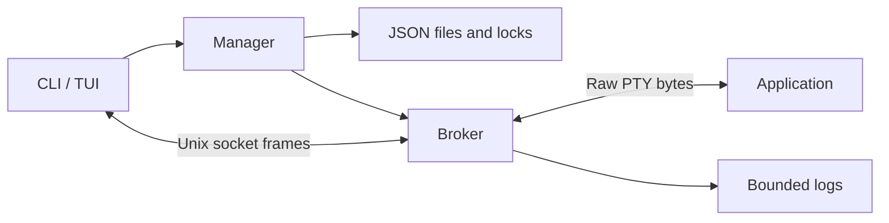

# Architecture

Each task runs in an independent broker, started by re-executing the binary as
`__broker` in a new process session. The broker owns the PTY, child process, logs
and runtime state. A readiness pipe synchronizes startup.

## Modules

| Module | Responsibility |
| --- | --- |
| task, store | Data, validation, atomic snapshots and file locks |
| protocol, ipc | Frames, Unix sockets, UID and instance checks |
| broker, daemon | Subscriptions, control ownership, supervision and logs |
| ptyprocess | PTY, resize, wait and process-session signals |
| service | Shared CLI/TUI operations and startup |
| terminal, vtscreen | Input, native forwarding, status viewport and cleanup |
| tui, monitor | Task list, dialogs and preview terminal |
| config, i18n, metrics, history | Settings, languages, resource sampling and expiry |

## Lifecycle and storage

A task becomes running after its listener and PTY are ready. The broker waits
for the child, records its exit status, drains output with a deadline and closes
clients. Stop sends TERM to the managed session, followed by KILL after one
second. Linux enumerates processes through `/proc`, and macOS uses system queries.

`spec.json` and `runtime.json` are separate snapshots. A catalog lock serializes
create, rename, delete and recover. Each broker holds its task's lock for its
lifetime. Writes use a temporary file, fsync, rename and directory fsync.
Directories are 0700, files 0600. Socket peers verify UID, task ID and broker
instance ID.

Recovery acquires the broker lock before updating stale metadata. It never
signals stored PIDs. A lost broker cannot recover its PTY.

Session order lives in `order.json`. Moves re-read it under the catalog lock
so concurrent frontends preserve each other's changes. A separate `__history`
worker removes expired records after their broker locks become available.
Retention defaults to one hour. Set it to zero to disable expiry.

## Connections

Each subscription has an approximately 2 MiB output queue. A slow client is
disconnected independently. Exclusive, takeover, read-only and shared modes use
the same stream. The oldest controller owns the PTY size. Permission checks and
complete input writes are serialized with control changes.

Each broker accepts at most 32 connections. Data frames are limited to 64 KiB,
control frames to 8 KiB. Logs retain two approximately 8 MiB files. Live output
continues after a log write failure.

Task children inherit `TDOCK_SESSION`, which blocks nested manager, new and
attach commands. Older sessions are detected through process ancestry and the
current catalog. Broker/history workers and management commands remain available.

## Terminal views

The TUI releases the terminal before attach enters raw mode. Attach opens a
separate `/dev/tty` and joins its cancellable reader before restoring termios.
Signals trigger graceful TUI cleanup.

Fullscreen attach uses a bounded VT with a fixed status row. Dirty rows are
painted at most 20 times per second. Session name and process-tree RSS refresh
every two seconds. The controlling frontend reserves one row in the PTY size.
`--no-status` forwards application output directly to the host terminal.

At reconnect, terminal modes and text styles are recovered from retained logs
and the instance's `terminal.json`. Native fullscreen applications receive a
temporary one-row resize and a redraw wait of up to two seconds. The status
view seeds its offscreen buffer without that resize. Captured startup output
replaces the seed to avoid displaying the first prompt twice.

The monitor renders retained logs in a separate VT and forwards keyboard input
through a shared connection. Followers track the owner's dimensions and crop
the screen to their panes. The session list takes a quarter of the width, capped
at 28 columns. Only the selected preview is active. Leaving the monitor retains
the PTY size. Repeated identical resize requests are ignored.

Ctrl+Q and F12 detach from fullscreen sessions.
Bracketed paste bypasses shortcuts. Split escape sequences are buffered and
incomplete sequences flush after 50 ms. `--no-escape` forwards every key.
In the monitor, ↑/↓ switches tasks, Shift+↑/↓ sends application arrows, and
Ctrl+Q/F12 or Esc returns to the list. Ctrl+F pauses forwarding for search.
Enter opens fullscreen from the task list.

VT screens are capped at 512×256 cells with about 4 MiB of parser buffering.
Historical queries and terminal side effects stay offscreen. Live fullscreen
cursor reports use application coordinates. Palette queries reach the host
terminal. Monitor device replies are disabled. Manager themes apply to controls, and
application cells retain their own colors.

See [protocol](protocol.md), [testing](stability.md) and
[compatibility](compatibility.md).
